# 03. Casos de uso — secções 4.2.x

Este documento descreve os casos de uso do sistema, baseados exclusivamente no
código real. Para cada caso de uso são indicados: actor, pré-condição, fluxo
principal, fluxos alternativos e pós-condição, com referência ao ficheiro e
função que o implementam.

## 3.1 Tabela actores x casos de uso

| Caso de uso | Estudante | Secretaria | Crédito | Registo | Admin |
| --- | --- | --- | --- | --- | --- |
| CU01 - Login clássico | ✓ | ✓ | ✓ | ✓ | ✓ |
| CU02 - Login Google institucional | ✓ | ✓ | ✓ | ✓ | ✓ |
| CU03 - Completar perfil académico | ✓ | — | — | — | — |
| CU04 - Submeter requerimento | ✓ | — | — | — | — |
| CU05 - Acompanhar estado dos meus pedidos | ✓ | — | — | — | — |
| CU06 - Ver detalhe do pedido | ✓ | — | — | — | — |
| CU07 - Descarregar anexos | ✓ (próprios/visíveis) | ✓ | ✓ (etapa crédito) | ✓ (etapa registo) | ✓ |
| CU08 - Tratamento na Secretaria (recepção) | — | ✓ | — | — | ✓ |
| CU09 - Validação pelo Controlo de Crédito | — | — | ✓ | — | ✓ |
| CU10 - Emissão/tratamento pelo Registo Académico | — | — | — | ✓ | ✓ |
| CU11 - Assinatura da direcção e marcar pronto | — | ✓ | — | — | ✓ |
| CU12 - Registar entrega física | — | ✓ | ✓ | ✓ | ✓ |
| CU13 - Indeferir pedido | — | ✓ | ✓ | ✓ | ✓ |
| CU14 - Pesquisar pedidos | — | ✓ | — | — | ✓ |
| CU15 - Ver painel de indicadores | — | ✓ | — | — | ✓ |
| CU16 - Gestão de utilizadores (admin) | — | — | — | — | ✓ |
| CU17 - Fazer backup (CLI) | — | — | — | — | ✓ |

*(deduzido dos decoradores em `contas/permissoes.py` e das views em
`pedidos/views.py` e `contas/views.py`)*

## 3.2 Descrição detalhada dos casos de uso

### CU01 — Login clássico

- **Actor:** qualquer utilizador com conta de pessoal ou de demonstração
- **Pré-condição:** utilizador não autenticado; credenciais válidas
- **Fluxo principal:**
  1. O utilizador acede a `/contas/login/`.
  2. Preenche username e palavra-passe.
  3. O sistema verifica se o username/IP não está bloqueado por excesso de
     falhas (`_login_bloqueado`).
  4. Se válido, autentica e redirecciona para a página inicial (`home`).
- **Fluxos alternativos:**
  - Se bloqueado: mostra mensagem de bloqueio e impede a tentativa
    (`contas/views.py`, linhas 69-86).
  - Se credenciais inválidas: mostra erro de utilizador/password
    (`templates/contas/login.html`, linhas 42-45).
  - Após sucesso: limpa apenas o contador de falhas do username
    (`contas/views.py`, linhas 90-94).
- **Pós-condição:** utilizador autenticado com sessão activa.
- **Referência:** `contas/views.py`, `LoginViewComLimite`, linhas 59-121;
  `contas/urls.py` linhas 9-13.

### CU02 — Login Google institucional

- **Actor:** qualquer utilizador com conta Google de domínio permitido
- **Pré-condição:** `GOOGLE_CLIENT_ID` e `GOOGLE_CLIENT_SECRET` configurados;
  email verificado e domínio em `ALLOWED_EMAIL_DOMAINS`
- **Fluxo principal:**
  1. O utilizador clica em "Entrar com Google institucional".
  2. É redireccionado para o Google; após consentir, retorna ao callback.
  3. O adapter valida o domínio do email no servidor.
  4. Se permitido, associa ao utilizador local existente ou cria sessão.
  5. Tenta atribuir número de estudante a partir do email.
- **Fluxos alternativos:**
  - Domínio não permitido: rejeita com mensagem e volta ao login
    (`contas/adapters.py`, linhas 46-52).
  - Email não verificado: rejeita (`contas/adapters.py`, linhas 40-44).
- **Pós-condição:** utilizador autenticado via Google; perfil de estudante
  criado se necessário.
- **Referência:** `contas/adapters.py`, `ContasSocialAccountAdapter`,
  linhas 28-113; `config/settings.py` linhas 235-262.

### CU03 — Completar perfil académico

- **Actor:** Estudante
- **Pré-condição:** utilizador autenticado com papel `estudante`; número de
  estudante identificado a partir do email
- **Fluxo principal:**
  1. O middleware `CompletarPerfilMiddleware` redirecciona para
     `/contas/completar-perfil/` se o perfil não estiver completo.
  2. O estudante escolhe um curso (activo) entre os agrupados por grau.
  3. O curso escolhido fixa o grau (`perfil.grau = perfil.curso.grau`).
  4. O telefone é opcional.
- **Fluxos alternativos:**
  - Se não há número de estudante: mostra página de bloqueio
    (`contas/views.py`, linhas 170-178).
  - Se o papel não for estudante: redirecciona para `home`
    (`contas/views.py`, linhas 165-166).
- **Pós-condição:** perfil completo; o estudante pode submeter pedidos.
- **Referência:** `contas/views.py`, `completar_perfil`, linhas 162-216;
  `contas/middleware.py`, `CompletarPerfilMiddleware`, linhas 17-65.

### CU04 — Submeter requerimento

- **Actor:** Estudante com perfil completo
- **Pré-condição:** autenticado; perfil completo (curso e número de estudante)
- **Fluxo principal:**
  1. Acede a `/pedidos/novo/`.
  2. Escolhe o tipo de documento (HTMX atualiza o resumo da taxa).
  3. Preenche o motivo.
  4. Anexa cópia do BI e comprovativo de pagamento (PDF, JPG ou PNG, ≤ 5 MB).
  5. Submete o formulário.
  6. O sistema cria o `Pedido` com `valor_total` congelado
     (taxa do tipo + IVA) e gera o protocolo `REQ-AAAA-NNNNN`.
  7. Cria dois `Anexo` (BI e comprovativo) visíveis ao estudante.
  8. Redirecciona para o detalhe do pedido.
- **Fluxos alternativos:**
  - Anexo inválido: rejeita sem criar nada
    (`pedidos/validators.py`, `validar_anexo`).
  - Tipo inactivo: não aparece nem é aceito
    (`pedidos/forms.py`, linha 41; `test_tipo_inactivo`).
- **Pós-condição:** pedido criado em `em_tratamento`, etapa
  `secretaria_recepcao`.
- **Referência:** `pedidos/views.py`, `novo_pedido`, linhas 90-146;
  `pedidos/models.py`, `Pedido.save`, linhas 176-189.

### CU05 — Acompanhar estado dos meus pedidos

- **Actor:** Estudante
- **Pré-condição:** autenticado como estudante
- **Fluxo principal:**
  1. Acede a `/pedidos/meus/`.
  2. Vê a lista paginada (25 por página) com protocolo, tipo, estado, etapa
     e data, incluindo a barra de progresso de cada pedido (etapas aplicáveis
     e etapa actual destacada).
  3. Clica em "Ver detalhe" para ver o detalhe de um pedido, incluindo a
     barra de progresso completa (variante full com datas/horas das etapas).
- **Pós-condição:** nenhum (consulta apenas).
- **Referência:** `pedidos/views.py`, `meus_pedidos`, linhas 166-177;
  `pedidos/models.py`, propriedade `progresso`;
  `templates/pedidos/meus_pedidos.html`,
  `templates/components/progress_steps.html`.

### CU06 — Ver detalhe do pedido

- **Actor:** Estudante (dono do pedido)
- **Pré-condição:** autenticado; pedido pertence ao utilizador
- **Fluxo principal:**
  1. Acede a `/pedidos/<pk>/`.
  2. Vê tipo, grau, motivo, valor total, etapa actual, data de submissão.
  3. Vê anexos visíveis com link de download.
  4. Se indeferido, vê o motivo do indeferimento.
- **Fluxos alternativos:**
  - Se o pedido não for do utilizador: responde 404
    (`pedidos/views.py`, `pedido_detalhe`, linhas 183-187).
- **Pós-condição:** nenhum (consulta apenas).
- **Referência:** `pedidos/views.py`, `pedido_detalhe`, linhas 182-193.

### CU07 — Descarregar anexos

- **Actor:** Estudante (dono), Secretaria, Crédito (etapa crédito),
  Registo (etapa registo), Admin
- **Pré-condição:** autenticado; anexo existe e tem permissão
- **Fluxo principal:**
  1. Acede a `/pedidos/anexo/<pk>/`.
  2. O sistema verifica `_pode_descarregar` (papel, etapa, visibilidade).
  3. Se permitido, devolve o ficheiro para download.
- **Fluxos alternativos:**
  - Sem permissão: responde 404 (não revela existência)
    (`pedidos/views.py`, `anexo_download`, linhas 232-233).
- **Pós-condição:** ficheiro transferido (ou 404).
- **Referência:** `pedidos/views.py`, `_pode_descarregar` (linhas 196-222)
  e `anexo_download` (linhas 226-252).

### CU08 — Tratamento na Secretaria (recepção)

- **Actor:** Secretaria ou Admin
- **Pré-condição:** autenticado com papel permitido; pedidos em
  `secretaria_recepcao`
- **Fluxo principal:**
  1. Acede à fila (`/pedidos/staff/fila/?tab=novos`).
  2. Abre o detalhe do pedido (`pedido_staff_detalhe`).
  3. Aprova (avança para `credito`) ou indefere (motivo ≥ 10 car.).
- **Pós-condição:** pedido avança para `credito` ou fica `indeferido`;
  decisão registada; notificação por email se indeferido.
- **Referência:** `pedidos/views.py`, `fila` (linhas 315-327),
  `aprovar` (linhas 658-670), `indeferir` (linhas 676-688);
  `pedidos/services.py`, `aprovar` (82-114), `indeferir` (117-150).

### CU09 — Validação pelo Controlo de Crédito

- **Actor:** Controlo de Crédito ou Admin
- **Pré-condição:** pedido na etapa `credito`
- **Fluxo principal:**
  1. Acede à fila do crédito (`/pedidos/staff/fila/`).
  2. Abre o detalhe do pedido (vê valor esperado e comprovativo).
  3. Aprova (avança para `registo` se `passa_registo_academico`, senão
     `secretaria_final`) ou indefere.
  4. Pode carregar extracto bancário (`carregar_extracto`).
- **Pós-condição:** pedido avança de etapa ou fica indeferido.
- **Referência:** `pedidos/views.py`, `fila` (linhas 334-340),
  `carregar_extracto` (linhas 722-757); `pedidos/services.py`, `aprovar`
  (linhas 98-102).

### CU10 — Emissão/tratamento pelo Registo Académico

- **Actor:** Registo Académico ou Admin
- **Pré-condição:** pedido na etapa `registo` (apenas tipos com
  `passa_registo_academico=True`)
- **Fluxo principal:**
  1. Acede à fila do registo.
  2. Aprova (avança para `secretaria_final`) ou indefere.
- **Pós-condição:** pedido avança para `secretaria_final` ou fica
  `indeferido`.
- **Referência:** `pedidos/views.py`, `fila` (linhas 341-347);
  `pedidos/services.py`, `aprovar` (linhas 103-104).

### CU11 — Assinatura da direcção e marcar pronto

- **Actor:** Secretaria ou Admin
- **Pré-condição:** pedido na etapa `secretaria_final`
- **Fluxo principal:**
  1. Acede à fila de assinatura (`?tab=assinatura`).
  2. Marca como pronto (apenas nesta etapa).
  3. O pedido fica `pronto` com `pronto_em` preenchido.
  4. Notifica o estudante por email.
- **Pós-condição:** pedido pronto para levantamento físico.
- **Referência:** `pedidos/views.py`, `fila` (tab assinatura, linhas 317-318),
  `marcar_pronto` (linhas 694-702); `pedidos/services.py`, `marcar_pronto`
  (linhas 153-176).

### CU12 — Registar entrega física

- **Actor:** Secretaria, Crédito, Registo ou Admin (qualquer staff)
- **Pré-condição:** pedido no estado `pronto`
- **Fluxo principal:**
  1. Abre o detalhe do pedido.
  2. Clica em "Registar entrega".
  3. O pedido fica `entregue` com `entregue_em` e `entregue_por`.
- **Pós-condição:** pedido entregue; decisão registada.
- **Referência:** `pedidos/views.py`, `marcar_entregue` (linhas 708-716);
  `pedidos/services.py`, `marcar_entregue` (linhas 179-202).

### CU13 — Indeferir pedido

- **Actor:** Secretaria, Crédito, Registo ou Admin (na respetiva etapa)
- **Pré-condição:** pedido em `em_tratamento` na etapa do actor
- **Fluxo principal:**
  1. Abre o detalhe do pedido.
  2. Preenche motivo (mínimo 10 caracteres).
  3. Submete indeferimento.
  4. O pedido fica `indeferido`; motivo e etapa registados.
  5. Notifica o estudante por email.
- **Pós-condição:** pedido indeferido; decisão imutável registada.
- **Referência:** `pedidos/views.py`, `indeferir` (linhas 676-688);
  `pedidos/services.py`, `indeferir` (linhas 117-150).

### CU14 — Pesquisar pedidos

- **Actor:** Secretaria ou Admin
- **Pré-condição:** autenticado com papel permitido
- **Fluxo principal:**
  1. Acede a `/pedidos/staff/pesquisa/`.
  2. Filtra por protocolo, nome, email, número de estudante, estado, etapa,
     tipo.
  3. Vê resultados paginados.
- **Pós-condição:** nenhum (consulta apenas).
- **Referência:** `pedidos/views.py`, `pesquisa`, linhas 357-406.

### CU15 — Ver painel de indicadores

- **Actor:** Secretaria ou Admin
- **Pré-condição:** autenticado com papel permitido
- **Fluxo principal:**
  1. Acede a `/painel/`.
  2. Vê cartões (total, em tratamento, prontos, entregues, indeferidos).
  3. Vê gráficos (tipos, estados, fila, indeferimentos) via Chart.js.
  4. Vê tabela de tempo médio por tipo e pedidos mais antigos.
  5. Filtra por período (`30d`, `mes`, `ano`, `tudo`).
- **Pós-condição:** nenhum (consulta apenas; sem dados pessoais de estudantes).
- **Referência:** `pedidos/views.py`, `painel`, linhas 442-580;
  `templates/pedidos/painel.html`.

### CU16 — Gestão de utilizadores (admin)

- **Actor:** Administrador
- **Pré-condição:** autenticado como admin/superutilizador
- **Fluxo principal:**
  1. Acede ao admin do Django (`/admin/`).
  2. Gere perfis (`PerfilAdmin`) e cursos (`CursoAdmin`).
  3. Gere tipos de documento, taxas e prazos (`TipoDocumentoAdmin`).
  4. Consulta (só-leitura) pedidos, anexos e decisões.
- **Pós-condição:** dados actualizados na base de dados.
- **Referência:** `contas/admin.py`, `pedidos/admin.py`.

### CU17 — Fazer backup (CLI)

- **Actor:** Administrador (via linha de comandos)
- **Pré-condição:** base de dados SQLite; pasta `BACKUP_DIR` escrevível
- **Fluxo principal:**
  1. Executa `python manage.py fazer_backup [--manter N]`.
  2. O sistema cria cópia consistente da SQLite (`Connection.backup`) e
     adiciona `media/` a um ZIP.
  3. Remove backups antigos além do limite (`--manter`, default 14).
  4. Imprime nome, tamanho e quantidade de backups restantes.
- **Pós-condição:** ficheiro ZIP de backup criado em `BACKUP_DIR`.
- **Referência:** `pedidos/management/commands/fazer_backup.py`.

## 3.3 Diagrama de casos de uso geral (Mermaid)

```mermaid
graph TD
    subgraph Actores
        E[Estudante]
        S[Secretaria]
        C[Controlo de Crédito]
        R[Registo Académico]
        A[Administrador]
    end

    subgraph Autenticação
        CU1[CU01 Login clássico]
        CU2[CU02 Login Google]
        CU3[CU03 Completar perfil]
    end

    subgraph Estudante
        CU4[CU04 Submeter requerimento]
        CU5[CU05 Acompanhar pedidos]
        CU6[CU06 Detalhe do pedido]
        CU7[CU07 Descarregar anexos]
    end

    subgraph Staff
        CU8[CU08 Tratamento Secretaria]
        CU9[CU09 Validação Crédito]
        CU10[CU10 Tratamento Registo]
        CU11[CU11 Marcar pronto]
        CU12[CU12 Registar entrega]
        CU13[CU13 Indeferir pedido]
        CU14[CU14 Pesquisar pedidos]
        CU15[CU15 Painel de indicadores]
    end

    subgraph Admin
        CU16[CU16 Gestão de utilizadores]
        CU17[CU17 Backup]
    end

    E --- CU1 & CU2 & CU3 & CU4 & CU5 & CU6 & CU7
    S --- CU1 & CU2 & CU8 & CU11 & CU12 & CU13 & CU14 & CU15 & CU7
    C --- CU1 & CU2 & CU9 & CU12 & CU13 & CU7
    R --- CU1 & CU2 & CU10 & CU12 & CU13 & CU7
    A --- CU1 & CU2 & CU8 & CU9 & CU10 & CU11 & CU12 & CU13 & CU14 & CU15 & CU16 & CU17
```

---
*Todos os factos são extraídos do código real do projecto.*