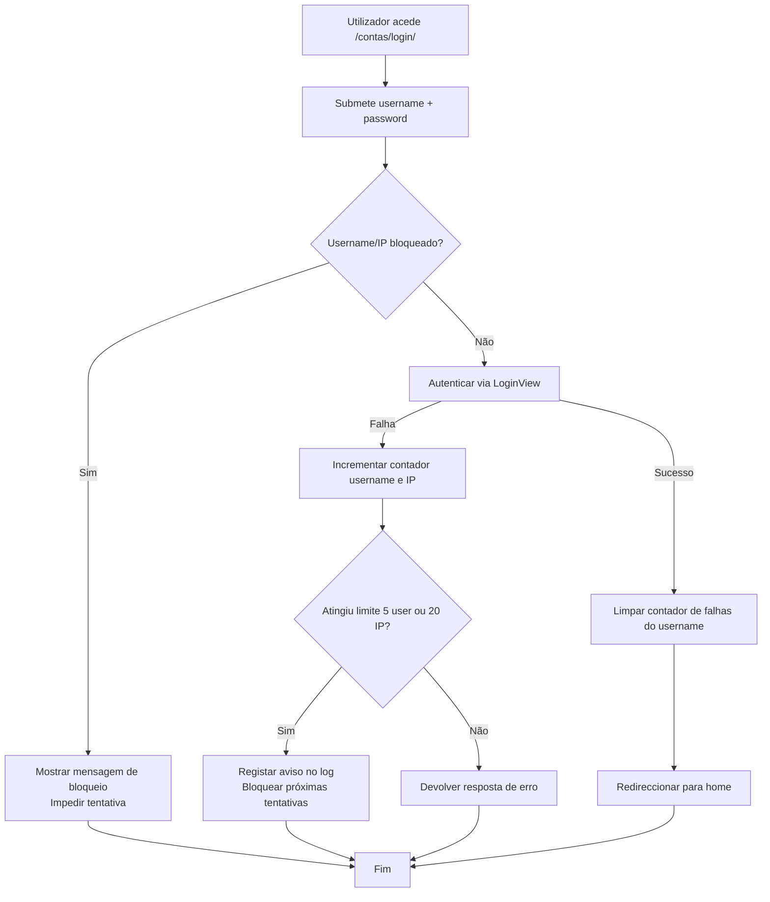
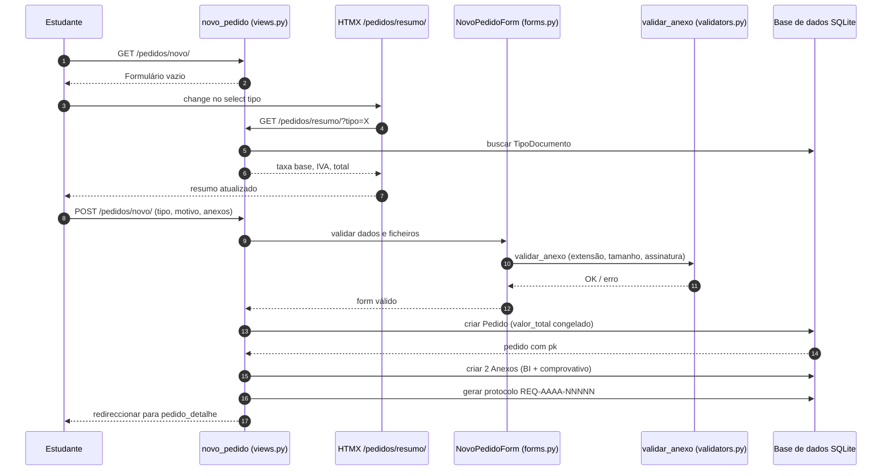
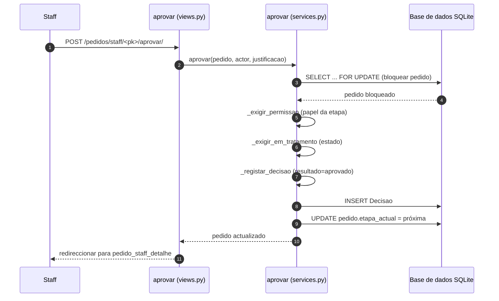
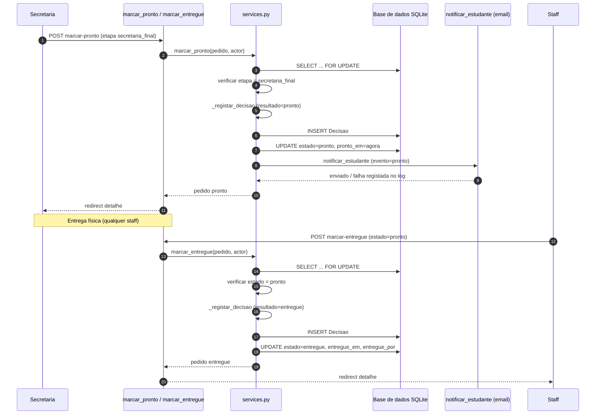
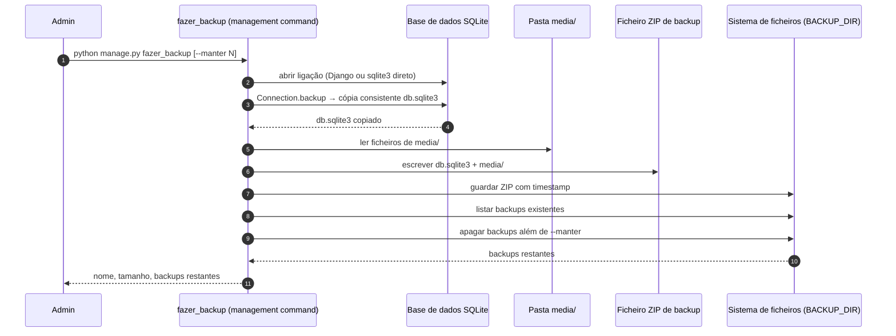

# 04. Diagramas de actividade e sequência — secções 4.3 e 4.4

Os diagramas abaixo são baseados exclusivamente no código real do projecto.
Cada um tem uma explicação curta e a referência ao ficheiro/função.

## 4.1 Diagrama de actividade — Login clássico com limite de tentativas

**Fluxo:** o utilizador submete credenciais; o sistema verifica se o
username ou IP está bloqueado; se não, autentica; em caso de falha,
incrementa contadores e bloqueia se atingir o limite.

**Referência:** `contas/views.py`, `LoginViewComLimite.post` (linhas 64-121),
`_login_bloqueado` (linhas 52-56), `_incrementar_faltas` (linhas 33-41).



## 4.2 Diagrama de sequência — Submissão de requerimento (estudante)

**Fluxo:** o estudante preenche o formulário, o resumo da taxa é buscado
via HTMX, e ao submeter o pedido é criado com valor congelado e anexos.

**Referência:** `pedidos/views.py`, `novo_pedido` (linhas 90-146),
`pedidos/models.py`, `Pedido.save` (linhas 176-189),
`pedidos/forms.py`, `NovoPedidoForm` (linhas 9-45),
`pedidos/validators.py`, `validar_anexo` (linhas 32-63).



## 4.3 Diagrama de actividade — Passagem entre departamentos (staff)

**Fluxo:** secretaria aprova → crédito; crédito aprova → registo (se
exigir) ou secretaria final; registo aprova → secretaria final;
secretaria final marca pronto; secretaria regista entrega.

**Referência:** `pedidos/services.py`, `aprovar` (linhas 82-114),
`PAPEIS_POR_ETAPA` (linhas 23-28), `ETAPAS_APROVACAO` (linhas 17-21).

```mermaid
flowchart TD
    A[Pedido criado<br>etapa: secretaria_recepcao] --> B[Secretaria aprova?]
    B -->|Sim| C[Etapa: credito]
    B -->|Não (indeferir)| D[Pedido indeferido<br>Fim do fluxo]
    C --> E[Crédito aprova?]
    E -->|Sim| F{passa_registo_academico?}
    F -->|Sim| G[Etapa: registo]
    F -->|Não| H[Etapa: secretaria_final]
    E -->|Não (indeferir)| D
    G --> I[Registo aprova?]
    I -->|Sim| H
    I -->|Não (indeferir)| D
    H --> J[Secretaria marca pronto<br>estado: pronto]
    J --> K[Staff regista entrega<br>estado: entregue]
    K --> L[Fim: documento entregue]
    D --> L
    L --> L
```

## 4.4 Diagrama de sequência — Aprovação de etapa (staff)

**Fluxo:** o membro de staff clica em "Aprovar etapa"; o serviço bloqueia o
pedido (`select_for_update`), verifica permissão e etapa, regista a decisão
e avança para a próxima etapa.

**Referência:** `pedidos/services.py`, `aprovar` (linhas 82-114),
`_bloquear` (44-49), `_exigir_permissao` (52-56), `_exigir_em_tratamento`
(59-63), `_registar_decisao` (66-73).



## 4.5 Diagrama de sequência — Marcar como pronto e entregar

**Fluxo:** secretaria marca como pronto (apenas em `secretaria_final`);
qualquer staff regista a entrega (apenas se `pronto`). Cada um regista uma
`Decisao` imutável e notifica o estudante (pronto).

**Referência:** `pedidos/services.py`, `marcar_pronto` (153-176),
`marcar_entregue` (179-202); `pedidos/notificacoes.py`, `notificar_estudante`
(43-79).



## 4.6 Diagrama de sequência — Backup consistente (fazer_backup)

**Fluxo:** o comando cria cópia consistente da SQLite via
`Connection.backup`, adiciona `media/` a um ZIP e remove backups antigos.

**Referência:** `pedidos/management/commands/fazer_backup.py`, `handle`
(linhas 45-86), `_copiar_base` (88-124), `_adicionar_media` (126-137).



---
*Todos os factos são extraídos do código real do projecto.*