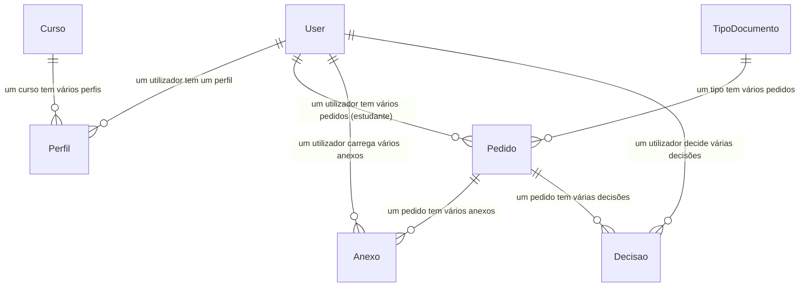

# 05. Modelo de dados — secções 5.2 e 5.3

## 5.1 Diagrama ER (Mermaid)

## 5.2 Dicionário de dados — contas

### Tabela `contas_curso`

| Campo | Tipo | Nulo | Descrição |
| --- | --- | --- | --- |
| id | Integer (PK) | Não | Identificador |
| nome | Varchar(150) | Não | Nome do curso |
| grau | Varchar(20) | Não | licenciatura / mestrado / doutoramento |
| activo | Boolean | Não | Se o curso está activo |

Constraint: `unique_curso_nome_por_grau` (nome + grau únicos).

**Ficheiro:** `contas/models.py`, classe `Curso`, linhas 29-54.

### Tabela `contas_perfil`

| Campo | Tipo | Nulo | Descrição |
| --- | --- | --- | --- |
| id | Integer (PK) | Não | Identificador |
| user_id | Integer (FK → auth_user) | Não | Utilizador Django (1:1) |
| papel | Varchar(20) | Não | estudante / secretaria / credito / registo / admin |
| numero_estudante | Varchar(30) | Sim | Extraído do email (não editável à mão) |
| curso_id | Integer (FK → contas_curso) | Sim | Curso do estudante (fixa o grau) |
| grau | Varchar(20) | Sim | licenciatura / mestrado / doutoramento |
| telefone | Varchar(20) | Sim | Telefone opcional |

Constraint: `unique_numero_estudante_quando_preenchido` (número único quando
preenchido). A propriedade `perfil_completo` é verdadeira quando `curso_id`
e `numero_estudante` estão preenchidos.

**Ficheiro:** `contas/models.py`, classe `Perfil`, linhas 57-153.

### Tabela `contas_dados_cursos` (não é modelo Django)

Ficheiro `contas/dados_cursos.py` define o catálogo estático de cursos por
grau (`CURSOS_POR_GRAU`, linhas 35-39), usado pelo comando
`carregar_cursos`.

## 5.3 Dicionário de dados — pedidos

### Tabela `pedidos_tipodocumento`

| Campo | Tipo | Nulo | Descrição |
| --- | --- | --- | --- |
| id | Integer (PK) | Não | Identificador |
| nome | Varchar(150) | Não | Nome do tipo (único) |
| taxa_licenciatura | Decimal(10,2) | Não | Taxa base para licenciatura |
| taxa_mestrado | Decimal(10,2) | Não | Taxa base para mestrado |
| taxa_doutoramento | Decimal(10,2) | Não | Taxa base para doutoramento |
| passa_registo_academico | Boolean | Não | Se exige validação do Registo |
| prazo_estimado_dias | Integer | Sim | Prazo em dias úteis (pode ser nulo) |
| activo | Boolean | Não | Se o tipo está disponível para pedido |

Métodos: `taxa_base(grau)`, `iva(grau)`, `total(grau)` (taxa + IVA).

**Ficheiro:** `pedidos/models.py`, classe `TipoDocumento`, linhas 25-67.

### Tabela `pedidos_pedido`

| Campo | Tipo | Nulo | Descrição |
| --- | --- | --- | --- |
| id | Integer (PK) | Não | Identificador |
| protocolo | Varchar(20) | Sim (único) | Gerado automaticamente: REQ-AAAA-NNNNN |
| estudante_id | Integer (FK → auth_user) | Não | Quem submeteu |
| tipo_id | Integer (FK → pedidos_tipodocumento) | Não | Tipo de documento |
| grau | Varchar(20) | Não | licenciatura / mestrado / doutoramento |
| motivo | Text | Não | Justificação do pedido |
| estado | Varchar(20) | Não | em_tratamento / indeferido / pronto / entregue |
| etapa_actual | Varchar(30) | Não | secretaria_recepcao / credito / registo / secretaria_final |
| motivo_indeferimento | Text | Sim | Motivo do indeferimento (se aplicável) |
| indeferido_na_etapa | Varchar(30) | Sim | Etapa onde foi indeferido |
| valor_total | Decimal(10,2) | Não | Congelado na criação (taxa + IVA) |
| criado_em | DateTime | Não | Auto-preenchido na criação |
| pronto_em | DateTime | Sim | Quando marcado como pronto |
| entregue_em | DateTime | Sim | Quando marcado como entregue |
| entregue_por_id | Integer (FK → auth_user) | Sim | Quem registou a entrega |

Propriedade `etapa_simples` devolve texto amigável do estado/etapa.

**Ficheiro:** `pedidos/models.py`, classe `Pedido`, linhas 82-189.

### Tabela `pedidos_anexo`

| Campo | Tipo | Nulo | Descrição |
| --- | --- | --- | --- |
| id | Integer (PK) | Não | Identificador |
| pedido_id | Integer (FK → pedidos_pedido) | Não | Pedido ao qual pertence |
| tipo | Varchar(20) | Não | bi / comprovativo / extracto / outro |
| ficheiro | FileField | Não | Ficheiro armazenado em media/pedidos/<ano>/ |
| nome_original | Varchar(255) | Não | Nome original do ficheiro enviado |
| visivel_ao_estudante | Boolean | Não | Se o estudante pode ver/descarregar |
| carregado_por_id | Integer (FK → auth_user) | Não | Quem carregou o ficheiro |
| carregado_em | DateTime | Não | Auto-preenchido |

O caminho do ficheiro usa UUID aleatório + extensão original (função
`caminho_anexo`). O nome enviado pelo utilizador nunca é usado no caminho.

**Ficheiro:** `pedidos/models.py`, classe `Anexo`, linhas 192-227.

### Tabela `pedidos_decisao`

| Campo | Tipo | Nulo | Descrição |
| --- | --- | --- | --- |
| id | Integer (PK) | Não | Identificador |
| pedido_id | Integer (FK → pedidos_pedido) | Não | Pedido relacionado |
| etapa | Varchar(30) | Não | Etapa onde a decisão foi tomada |
| resultado | Varchar(20) | Não | aprovado / indeferido / pronto / entregue |
| justificacao | Text | Sim | Justificação da decisão |
| decidido_por_id | Integer (FK → auth_user) | Não | Quem tomou a decisão |
| data_hora | DateTime | Não | Auto-preenchido na criação |

As decisões são imutáveis: `save` em registo existente e `delete` levantam
`DecisaoImutavelError`.

**Ficheiro:** `pedidos/models.py`, classe `Decisao`, linhas 234-283.

## 5.4 Fluxo de estados do pedido

Estados (`ESTADO_CHOICES`):
- `em_tratamento` (inicial)
- `indeferido` (final)
- `pronto` (final, aguarda levantamento)
- `entregue` (final)

Etapas (`ETAPA_CHOICES`):
- `secretaria_recepcao` (inicial)
- `credito`
- `registo` (apenas se `passa_registo_academico`)
- `secretaria_final`

Transições (apenas em `em_tratamento`, com bloqueio `select_for_update`):

| Etapa actual | Actor permitido | Acção | Próxima etapa / estado |
| --- | --- | --- | --- |
| secretaria_recepcao | Secretaria / Admin | aprovar | credito |
| secretaria_recepcao | Secretaria / Admin | indeferir | indeferido |
| credito | Crédito / Admin | aprovar | registo (se passa_registo) senão secretaria_final |
| credito | Crédito / Admin | indeferir | indeferido |
| registo | Registo / Admin | aprovar | secretaria_final |
| registo | Registo / Admin | indeferir | indeferido |
| secretaria_final | Secretaria / Admin | marcar_pronto | estado pronto |
| pronto | Qualquer staff | marcar_entregue | estado entregue |

**Ficheiro:** `pedidos/services.py`, `aprovar` (linhas 82-114),
`indeferir` (117-150), `marcar_pronto` (153-176), `marcar_entregue` (179-202);
`pedidos/models.py`, linhas 83-105.

---
*Todos os factos são extraídos do código real do projecto.*