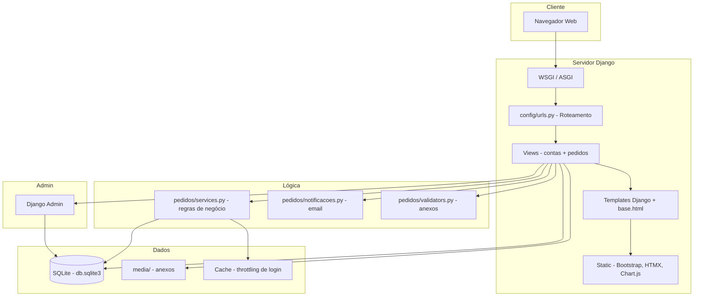
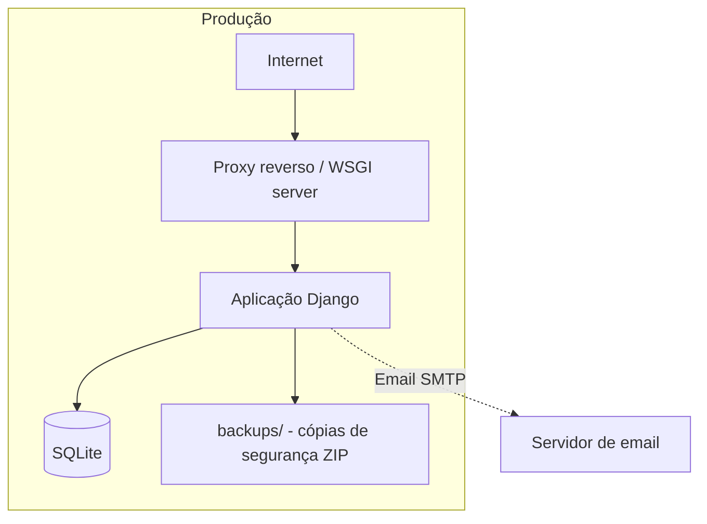

# 07. Arquitectura — secção 5.5

## 7.1 Padrão arquitectural

O projecto segue o padrão **MTV (Model-Template-View)** do Django, com uma
camada adicional de **serviços de domínio** (`pedidos/services.py`) que
centraliza as regras de negócio. As views limitam-se a validar a entrada do
utilizador e a chamar os serviços.

**Ficheiro:** `pedidos/services.py` (docstring, linhas 1-5):
"Toda a lógica de transição de etapas e de registo de decisões vive aqui. As
vistas limitam-se a validar a entrada do utilizador e a chamar estes
serviços."

## 7.2 Módulos e responsabilidades

| Camada | Módulo | Responsabilidade |
| --- | --- | --- |
| Configuração | `config/settings.py` | Settings, segurança, DB, cache, email, taxas |
| Roteamento | `config/urls.py` | URLs raiz e inclusão das apps |
| Apresentação | `templates/` + `pedidos/views.py`, `contas/views.py` | Templates Django, views, HTMX |
| Lógica de negócio | `pedidos/services.py` | Transições de etapa, decisões, permissões |
| Dados | `pedidos/models.py`, `contas/models.py` | Modelos ORM, validações de campo |
| Validação | `pedidos/validators.py` | Validação de anexos (extensão, tamanho, assinatura) |
| Notificações | `pedidos/notificacoes.py` | Email ao estudante (falha silenciosa no log) |
| Autenticação | `contas/adapters.py`, `contas/views.py` | Login clássico com limite, Google OAuth |
| Middleware | `contas/middleware.py` | Obriga perfil completo do estudante |
| Gestão | `pedidos/management/commands/` | Backup, seed_demo, carregar_cursos, importar_utilizadores |

## 7.3 Fluxo de um pedido ponta-a-ponta

1. **Autenticação:** estudante faz login (clássico com limite de tentativas
   ou Google institucional).
2. **Perfil:** se o perfil não estiver completo, é redireccionado para
   `completar_perfil` (middleware `CompletarPerfilMiddleware`).
3. **Submissão:** preenche tipo, motivo e anexos; o resumo da taxa é buscado
   via HTMX (`/pedidos/resumo/`); ao submeter, o pedido é criado com
   `valor_total` congelado e protocolo gerado.
4. **Tratamento:** secretaria aprova/indefer; crédito valida pagamento e
   carrega extracto; registo valida percurso académico (se exigir);
   secretaria final marca pronto; staff regista entrega.
5. **Notificação:** email ao estudante quando pronto ou indeferido.
6. **Acompanhamento:** estudante consulta `meus_pedidos` e `pedido_detalhe`.
7. **Gestão:** admin consulta o painel de indicadores (`/painel/`), pesquisa
   pedidos e gere dados via admin do Django.

## 7.4 Segurança

### Autenticação
- Dois backends: `ModelBackend` (clássico) e `AllauthAuthenticationBackend`
  (social/Google).
- Login clássico com throttling por username (5 falhas) e IP (20 falhas) na
  janela de 15 minutos.
- Google OAuth com validação de domínio institucional no servidor
  (`ALLOWED_EMAIL_DOMAINS`).

**Ficheiro:** `config/settings.py` linhas 102-105; `contas/views.py`;
`contas/adapters.py`.

### Autorização
- Decoradores de papel (`estudante_required`, `secretaria_required`, etc.)
  levantam `PermissionDenied`, que usa o template 403 temático.
- Verificação de etapa nas decisões (`pode_decidir`, `PAPEIS_POR_ETAPA`).
- Verificação de propriedade de pedido (`pedido_detalhe` filtra por
  `estudante=request.user`).

**Ficheiro:** `contas/permissoes.py`; `pedidos/services.py` (`pode_decidir`);

### CSRF e cabeçalhos de segurança
- CSRF middleware activado; `CSRF_TRUSTED_ORIGINS` configurável.
- `X_FRAME_OPTIONS = "DENY"`, `SECURE_CONTENT_TYPE_NOSNIFF = True`,
  `SECURE_REFERRER_POLICY = "same-origin"`,
  `SECURE_CROSS_ORIGIN_OPENER_POLICY = "same-origin"`.
- HSTS configurável por ambiente (`DJANGO_HSTS_SECONDS`, etc.).
- Cookies de sessão e CSRF seguros quando `DEBUG=False`; `SECURE_SSL_REDIRECT`
  em produção.

**Ficheiro:** `config/settings.py` linhas 48-65.

### Ficheiros de media
- Não há `MEDIA_URL` público; não existe rota que sirva `media/` directamente.
- Todas as descargas passam por `pedidos:anexo_download`, que verifica
  permissões antes de entregar o ficheiro.

**Ficheiro:** `config/settings.py` linhas 215-217; `pedidos/views.py`
`_pode_descarregar` (linhas 196-222).

## 7.5 Diagramas Mermaid

### Componentes

### Implantação (deduzida)

*(deduzido: não há ficheiro de configuração de servidor Web no projecto;
a implantação em produção é configurada via variáveis de ambiente e
`check --deploy`)*

## 7.6 Tecnologias de frontend

- Bootstrap 5 (CSS e JS) — `static/vendor/bootstrap/`
- Bootstrap Icons — ícones na interface
- HTMX — resumo assíncrono da taxa no novo pedido
- Chart.js — gráficos do painel de indicadores
- CSS próprio — `static/css/ucm-theme.css` (tema UCM-FEG)

---
*Todos os factos são extraídos do código real do projecto.*